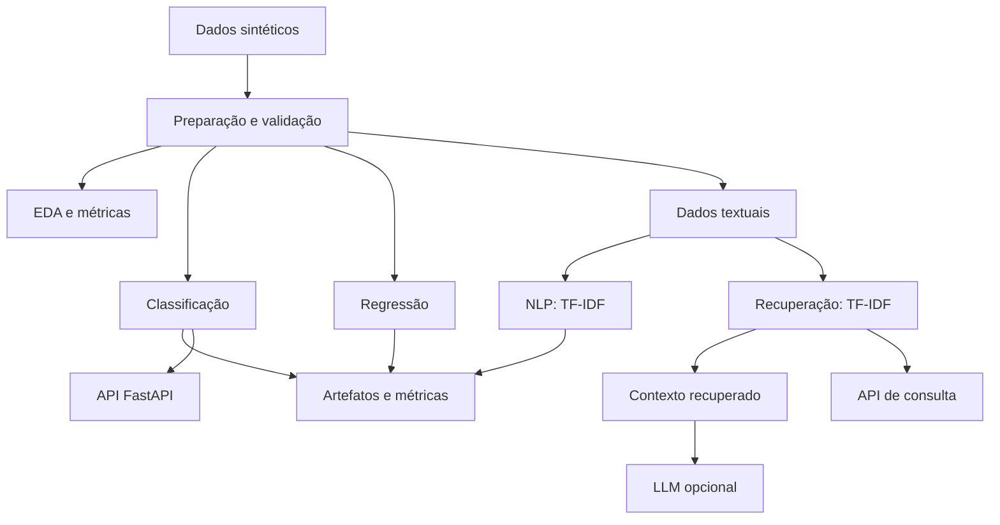

# Arquitetura do FoodFlow AI

## Visão geral

O repositório implementa um pipeline experimental de Engenharia de IA com dados sintéticos. A execução cobre preparação de dados, análise exploratória, treinamento e avaliação de modelos, processamento de texto, recuperação de informação e disponibilização de funcionalidades por API.

## Componentes

1. **Dados** — geração determinística de tabelas sintéticas para experimentos.
2. **Análise** — estatísticas descritivas, agregações e relatórios exploratórios.
3. **Classificação** — pipeline com imputação, codificação de variáveis categóricas e Logistic Regression.
4. **Regressão** — pipeline de pré-processamento e Random Forest Regressor.
5. **NLP** — baseline de classificação de texto com TF-IDF e Logistic Regression; inferência opcional com Transformers.
6. **Recuperação e RAG** — busca lexical por TF-IDF e similaridade de cosseno; geração com LLM é opcional.
7. **Serving** — endpoints FastAPI para health check, previsão de classificação e recuperação de texto.
8. **Validação** — testes automatizados e workflow GitHub Actions.

## Reprodutibilidade

Os dados, modelos e relatórios são gerados durante a execução e não precisam ser versionados. A semente aleatória é definida no gerador para tornar a criação dos dados reproduzível.

> Os dados são artificiais. Métricas obtidas com eles servem para validar o pipeline e não representam desempenho em dados reais.
