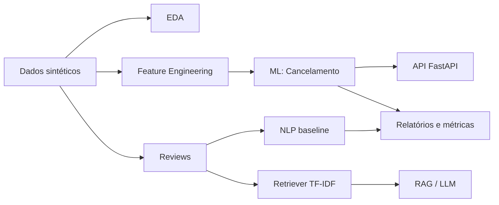

# 🏗️ Arquitetura FoodFlow AI

## Camadas

1. **Data** — geração reprodutível de clientes, restaurantes, entregadores, pedidos, pagamentos e avaliações.
2. **Analytics** — análise exploratória e indicadores operacionais.
3. **ML** — previsão de cancelamento com pipeline de pré-processamento + Logistic Regression.
4. **NLP** — classificação de sentimento como baseline e inferência opcional com Hugging Face.
5. **RAG** — recuperação de avaliações relevantes antes da geração de uma resposta.
6. **Serving** — API FastAPI e container Docker.
7. **MLOps** — testes e execução automatizada via GitHub Actions.

O projeto usa dados sintéticos para demonstrar arquitetura e engenharia sem expor dados pessoais ou operacionais reais.
